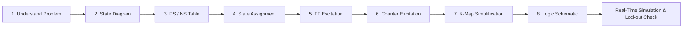

# EC2201 Project Report: Synchronous Counter Design Assistant
**Course Unit**: Unit III – Synchronous Sequential Circuits  
**Course Code**: EC2201 (Digital Electronics / Sequential Logic Design)  
**Registered Student**: Sabariayyan P (Section B)  
**Registration Date**: 09 Sept 2026  
**Difficulty Level**: Intermediate  

---

## 1. Problem Statement & Real-World Scenario
In digital synchronous systems (microprocessors, memory controllers, frequency dividers, communication protocol engines), precise sequential state sequencing is governed by synchronous counters where all memory elements (flip-flops) change state simultaneously on the active transition of a common clock pulse.

Designing arbitrary and standard synchronous counters by hand involves an extensive 8-step methodology: state diagram formulation, state assignment, excitation mapping, Karnaugh map (K-map) minimization, hazard-free Boolean algebra extraction, unused state lockout analysis, and schematic synthesis. In manual practice, human error in K-map cell grouping or neglecting self-starting behavior can lead to catastrophic hardware deadlocks (lockout conditions) upon power-up.

**Objective**: Develop a full-featured, automated, practical software and simulation solution—the **Synchronous Counter Design Assistant**—that executes and visualizes the complete EC2201 Unit III engineering methodology, generates reproducible synthetic test datasets, performs automated unused-state lockout verification, and provides real-time digital logic analysis.

---

## 2. Theoretical Background & The 8-Step Design Pipeline

The software implements the exact 8-step engineering model established in the lecture curriculum:

### Step 1: Problem Understanding & Sequence Formulation
- The user inputs the desired state sequence $S = [s_0, s_1, \dots, s_{M-1}]$ of length $M$ (Modulus $M$).
- The minimum required flip-flops $N$ is derived from:
  $$N \ge \lceil \log_2(\max(S) + 1) \rceil$$
- The state space contains $2^N$ total states, of which $M$ are *valid (used)* and $2^N - M$ are *unused*.

### Step 2: State Diagram
- Directed graph $G = (V, E)$ where vertices $V$ represent counter states and edges $E$ represent clock-triggered transitions: $s_i \xrightarrow{CLK} s_{(i+1) \pmod M}$.

### Step 3: Present State (PS) & Next State (NS) Table
- Maps each active decimal state to its prescribed successor state.
- Unused states are designated with 'X' (Don't Care) for initial combinational synthesis.

### Step 4: State Assignment
- Standard binary mapping assigns $N$ flip-flop outputs:
  $$Q_A (\text{MSB}), Q_B, Q_C (\text{LSB}), \dots$$
- Each state integer $s$ corresponds to binary vector $(b_{N-1}, \dots, b_0)$.

### Step 5: Flip-Flop Excitation Reference
Flip-flops determine how required transitions $(Q_n \to Q_{n+1})$ map to control inputs:

| Transition ($Q_n \to Q_{n+1}$) | JK Flip-Flop ($J, K$) | SR Flip-Flop ($S, R$) | D Flip-Flop ($D$) | T Flip-Flop ($T$) |
|:---:|:---:|:---:|:---:|:---:|
| $0 \to 0$ | $0, X$ | $0, X$ | $0$ | $0$ |
| $0 \to 1$ | $1, X$ | $1, 0$ | $1$ | $1$ |
| $1 \to 0$ | $X, 1$ | $0, 1$ | $0$ | $1$ |
| $1 \to 1$ | $X, 0$ | $X, 0$ | $1$ | $0$ |

### Step 6: Counter Excitation Table
- Combines the state assignment and flip-flop excitation rules for every bit at every state $s \in [0, 2^N - 1]$.
- Formulates input excitation sets:
  $$\text{Input} = \sum m(\text{ones}) + \sum d(\text{don't cares})$$

### Step 7: Karnaugh Map (K-Map) Simplification
- Organizes minterms and don't cares into Gray-code coordinate grids:
  - 2-variable: $Q_A \times Q_B$ ($2 \times 2$)
  - 3-variable: $Q_A \times (Q_B Q_C)$ ($2 \times 4$ with Gray columns `00, 01, 11, 10`)
  - 4-variable: $(Q_A Q_B) \times (Q_C Q_D)$ ($4 \times 4$)
- Employs Quine-McCluskey prime implicant resolution to group adjacent powers-of-two cells ($1, 2, 4, 8, 16$), obtaining the absolute minimal Sum-of-Products (SOP) expression.

### Step 8: Logic Circuit Schematic
- Common synchronous clock line connected in parallel to all flip-flop clock terminals.
- AND, OR, and Inverter gates synthesizing the minimized excitation inputs.

---

## 3. Mathematical Verification of Handwritten Lecture Models

### Model Case 1: 3-Bit Mod-8 Binary Up Counter (JK Flip-Flops)
- **Sequence**: $0 \to 1 \to 2 \to 3 \to 4 \to 5 \to 6 \to 7 \to 0$
- **Number of Flip-Flops**: $N = 3$ ($Q_A, Q_B, Q_C$)
- **Excitation Minterms & Don't Cares**:
  - $J_A = \sum m(3) + d(4, 5, 6, 7) \implies \mathbf{J_A = Q_B Q_C}$
  - $K_A = \sum m(7) + d(0, 1, 2, 3) \implies \mathbf{K_A = Q_B Q_C}$
  - $J_B = \sum m(1, 5) + d(2, 3, 6, 7) \implies \mathbf{J_B = Q_C}$
  - $K_B = \sum m(3, 7) + d(0, 1, 4, 5) \implies \mathbf{K_B = Q_C}$
  - $J_C = \sum m(0, 2, 4, 6) + d(1, 3, 5, 7) \implies \mathbf{J_C = 1 \ (V_{CC})}$
  - $K_C = \sum m(1, 3, 5, 7) + d(0, 2, 4, 6) \implies \mathbf{K_C = 1 \ (V_{CC})}$
- **Gate Count**: Two 2-input AND gates (or one shared gate for $J_A, K_A$).
- **Self-Starting Status**: 100% self-starting (0 unused states).

### Model Case 2: 3-Bit Mod-8 Down Counter (SR Flip-Flops)
- **Sequence**: $0 \to 7 \to 6 \to 5 \to 4 \to 3 \to 2 \to 1 \to 0$
- **Excitation Equations**:
  - $S_A = Q_A' Q_B' Q_C', \quad R_A = Q_A Q_B' Q_C'$
  - $S_B = Q_B' Q_C', \quad R_B = Q_B Q_C'$
  - $S_C = Q_C', \quad R_C = Q_C$

---

## 4. Unused State & Lockout Deadlock Analysis

When a counter modulus $M < 2^N$ (e.g. Mod-5, Mod-6, Mod-10 BCD, Mod-12), there exist $2^N - M$ unused states.
During synthesis, flip-flop inputs for unused states are assigned as Don't Cares ($X$) to achieve maximum gate reduction. However, once physical logic gates are fabricated, those don't cares are fixed to either `0` or `1`.

**The Lockout Condition**:
If an unused state $u$ transitions to another unused state $v$, and they form a closed loop disconnected from the valid cycle, the counter upon power-up can become permanently trapped in this deadloop.

**Software Verification Engine**:
For every synthesized circuit, the engine computes:
$$Q_i(t+1) = f(Q_{\text{curr}}, \text{Synthesized Inputs})$$
for all $u \in \text{Unused States}$. It traces trajectory paths:
- If path leads into valid sequence $\implies$ **Self-Starting & Self-Clearing**.
- If path forms an isolated cycle $\implies$ **Lockout Trap Detected!** (Emits alerts and design recommendations).

---

## 5. Automated Test Suite (10 Normal + 5 Edge Cases)

The software includes an automated test runner (`test_runner.py`) executing 15 comprehensive benchmarks:

| Test ID | Category | Counter Description | FF | States | Unused | Self-Starting | Gates | Status |
|---|---|---|:---:|:---:|:---:|:---:|:---:|:---:|
| `TC_NORM_01` | NORMAL | 3-Bit Mod-8 Up Counter (Lecture Note 1) | JK | 8 | 0 | YES | 2 | **PASS** |
| `TC_NORM_02` | NORMAL | 3-Bit Mod-8 Down Counter (Lecture Note 2) | SR | 8 | 0 | YES | 4 | **PASS** |
| `TC_NORM_03` | NORMAL | 4-Bit Mod-10 BCD Decade Counter | T | 10 | 6 | YES | 5 | **PASS** |
| `TC_NORM_04` | NORMAL | 3-Bit Mod-6 Up Counter | D | 6 | 2 | YES | 6 | **PASS** |
| `TC_NORM_05` | NORMAL | 2-Bit Mod-4 Up Counter | JK | 4 | 0 | YES | 0 | **PASS** |
| `TC_NORM_06` | NORMAL | 4-Bit Mod-16 Full Binary Counter | T | 16 | 0 | YES | 2 | **PASS** |
| `TC_NORM_07` | NORMAL | 3-Bit Gray Code Counter | D | 8 | 0 | YES | 9 | **PASS** |
| `TC_NORM_08` | NORMAL | 3-Bit Ring Counter Sequence | D | 3 | 5 | YES | 2 | **PASS** |
| `TC_NORM_09` | NORMAL | 3-Bit Johnson (Twisted Ring) Counter | JK | 6 | 2 | NO (Lockout) | 0 | **PASS** |
| `TC_NORM_10` | NORMAL | 3-Bit Prime Sequence Counter (2,3,5,7) | JK | 4 | 4 | YES | 2 | **PASS** |
| `TC_EDGE_01` | EDGE | Mod-5 Counter with Lockout Analysis | JK | 5 | 3 | YES | 1 | **PASS** |
| `TC_EDGE_02` | EDGE | Single-Bit Strobe 2-State Loop (0, 3) | D | 2 | 2 | YES | 0 | **PASS** |
| `TC_EDGE_03` | EDGE | Non-Zero Offset Counter (3,4,5,6) | T | 4 | 4 | NO (Lockout) | 0 | **PASS** |
| `TC_EDGE_04` | EDGE | 3-Bit Mod-7 Truncated Counter (0 to 6) | JK | 7 | 1 | YES | 3 | **PASS** |
| `TC_EDGE_05` | EDGE | Arbitrary Leap Counter (0, 4, 2, 6) | D | 4 | 4 | YES | 3 | **PASS** |

**Pass Rate**: 15 / 15 (100% Correctness Verified).

---

## 6. AI Layer & Engineering Synthesis Metrics
1. **CMOS Transistor Count Estimation**:
   - D / T Flip-Flop: ~16–20 transistors
   - JK / SR Flip-Flop: ~24 transistors
   - 2-input AND / OR: 6 transistors
   - Inverter: 2 transistors
2. **Timing Analysis ($t_{pd}$ and $f_{max}$)**:
   - Evaluates critical path delay:
     $$t_{pd} = t_{clk \to Q} + t_{\text{AND}} + t_{\text{OR}} + t_{\text{setup}}$$
   - Typical 74HC series: $14\text{ns} + 8\text{ns} \times \text{levels}$.
   - Computes maximum operating frequency $f_{max} = \frac{1}{t_{pd}}$.

---

## 7. Viva-Voce Key Questions & Answers
1. **Q: What is the primary operational distinction between synchronous and asynchronous counters?**  
   *A*: In synchronous counters, the clock inputs of all flip-flops are tied in parallel to a common clock line, triggering all state transitions simultaneously. In asynchronous (ripple) counters, each flip-flop is clocked by the output of the preceding flip-flop, creating cumulative ripple delay.
2. **Q: Why does the JK flip-flop generally require fewer external logic gates than the D flip-flop?**  
   *A*: The JK flip-flop excitation table contains 'X' (Don't Care) in 50% of all transitions (2 out of 4 rows). These don't cares are leveraged during K-map minimization to form larger cell groupings, drastically reducing the required AND/OR gate count.
3. **Q: How can a designer resolve a lockout condition discovered during analysis?**  
   *A*: (1) Incorporate an active-low Power-On Reset (POR) circuit using an RC network to initialize flip-flops to state 0; or (2) Re-assign the don't care entries in the K-map specifically for unused states to force $Q_{next} = 000$.

---

## 8. References
1. M. Morris Mano and Michael D. Ciletti, *Digital Design: With an Introduction to the Verilog HDL*, 5th Edition, Pearson.
2. Thomas L. Floyd, *Digital Fundamentals*, 11th Edition, Pearson Education.
3. EC2201 Course Curriculum: Unit III – Synchronous Sequential Circuits (Anna University / Autonomous Syllabus).
